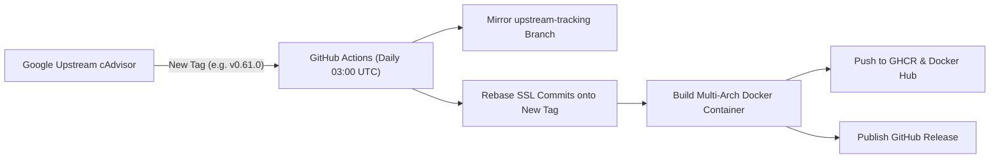

<div align="center">


# cAdvisor with Native SSL / TLS Support

[](https://github.com/udp1024/cAdvisor-SSL/actions/workflows/rebase-and-build.yml)
[](https://github.com/udp1024/cAdvisor-SSL/releases)
[](https://github.com/udp1024/cAdvisor-SSL)
[](https://github.com/users/udp1024/packages/container/package/cadvisor-ssl)
[](https://hub.docker.com/r/udp1024/cadvisor-ssl)
[](LICENSE)

An enterprise-ready, enhanced distribution of Google's **[cAdvisor](https://github.com/google/cadvisor)** with **native SSL/TLS and Mutual TLS (mTLS) support**, automated upstream release tracking, and smart container healthchecks.

</div>

---

## 📑 Table of Contents
- [Why cAdvisor-SSL?](#-why-cadvisor-ssl)
  - [The Problem with Vanilla cAdvisor](#the-problem-with-vanilla-cadvisor)
  - [Why Native SSL vs. Sidecar Proxies?](#why-native-ssl-vs-sidecar-proxies)
  - [The Solution](#the-solution)
- [✨ Key Features](#-key-features)
- [📦 Container Registries & Image Tags](#-container-registries--image-tags)
  - [🖥️ Supported Architectures (Multi-Arch)](#️-supported-architectures-multi-arch)
- [🔒 SSL / TLS Command-Line Flags](#-ssl--tls-command-line-flags)
- [🚀 Quick Start & Usage Examples](#-quick-start--usage-examples)
  - [1. Generate Certificates (Test / Self-Signed)](#1-generate-certificates-test--self-signed)
  - [2. Run with Docker](#2-run-with-docker)
  - [3. Run with Docker Compose](#3-run-with-docker-compose)
  - [4. Deploy to Kubernetes (DaemonSet)](#4-deploy-to-kubernetes-daemonset)
  - [5. Scrape with Prometheus](#5-scrape-with-prometheus)
- [🤖 Automated Upstream Release Tracking](#-automated-upstream-release-tracking)
- [License & Credits](#license--credits)

---

## 💡 Why cAdvisor-SSL?

### The Problem with Vanilla cAdvisor
Google's official cAdvisor daemon only serves its web interface and Prometheus metrics (`/metrics`) over **unencrypted plaintext HTTP**. 

In modern production environments:
* **Security & Compliance**: Regulations like **PCI-DSS**, **HIPAA**, **SOC 2**, and **FedRAMP** strictly prohibit transmitting infrastructure metrics and host internals in cleartext. Plaintext metrics reveal process command lines, environment configurations, container names, and hardware topologies over internal networks.
* **Zero Trust Networks**: Modern Kubernetes clusters and hybrid-cloud infrastructures enforce encryption in transit for all service-to-service communications.

### Why Native SSL vs. Sidecar Proxies?
Traditionally, organizations secure cAdvisor by running a reverse proxy sidecar (such as Nginx, Envoy, Caddy, or Ghostunnel) in front of every cAdvisor instance. While viable, sidecars introduce major drawbacks:

| Metric | Sidecar Proxy (e.g. Nginx/Envoy) | Native cAdvisor-SSL |
| :--- | :--- | :--- |
| **Containers per Node** | 2 containers (proxy + cAdvisor) | **1 lightweight container** |
| **Memory Footprint** | Additional 50MB - 150MB per node | **0MB extra memory** (built into Go binary) |
| **Port & Loopback Routing** | Complex localhost forwarding | **Direct TLS port binding** |
| **DaemonSet Complexity** | Shared network namespaces, extra configs | **Standard single-container DaemonSet** |
| **Failure Points** | Proxy crashes leave cAdvisor unreachable | **Zero intermediary failure points** |

### The Solution
**`cAdvisor-SSL`** adds first-class, standard-library TLS directly into cAdvisor's HTTP server:
* Uses Go's high-performance `crypto/tls` and `crypto/x509` packages.
* Introduces zero external third-party dependencies.
* Completely backward compatible: falls back to standard HTTP if no certificates are provided.

---

## ✨ Key Features

* 🔐 **Native TLS 1.2 & 1.3**: Direct SSL termination on any port you specify.
* 🛡️ **Mutual TLS (mTLS) Authentication**: Restrict Prometheus scraping to clients presenting valid client certificates signed by your CA (`-tls_client_ca_file`).
* 🖥️ **Multi-Architecture Support**: Built for both **`linux/amd64`** (x86_64) and **`linux/arm64`** (AArch64) processors.
* 🩺 **Smart HTTPS Healthcheck**: The container healthcheck (`/healthz`) automatically detects when TLS is active and queries over HTTPS without certificate validation errors.
* 🔄 **Automated Upstream Rebase**: Tracks Google's official release tags automatically via GitHub Actions. When Google releases a new version, a matching `-ssl` container is published within 24 hours.
* 📦 **Multi-Registry Publishing**: Available from both **GitHub Container Registry (GHCR)** and **Docker Hub**.

---

## 📦 Container Registries & Image Tags

Images are published to both GitHub Container Registry and Docker Hub:

| Registry | Image URL |
| :--- | :--- |
| **GitHub Container Registry** | `ghcr.io/udp1024/cadvisor-ssl:<version>-ssl`<br>`ghcr.io/udp1024/cadvisor-ssl:latest` |
| **Docker Hub** | `udp1024/cadvisor-ssl:<version>-ssl`<br>`udp1024/cadvisor-ssl:latest` |

### 🖥️ Supported Architectures (Multi-Arch)

Every image tag is published as an OCI multi-architecture manifest list. When you run `docker pull` or `docker run`, Docker automatically detects and pulls the matching image for your CPU architecture:

| Architecture | Docker Platform | Targeted Processors & Hardware |
| :--- | :--- | :--- |
| **AMD64 / x86_64** | `linux/amd64` | Intel Xeon / Core, AMD EPYC / Ryzen, Standard Cloud VMs (AWS, GCP, Azure, Hetzner, DigitalOcean) |
| **ARM64 / AArch64** | `linux/arm64` | AWS Graviton (c6g, c7g, m6g, t4g), Apple Silicon (M1/M2/M3/M4 via Docker Desktop), Ampere Altra, Raspberry Pi 4 / 5 (64-bit OS) |

#### Verify Multi-Platform Manifest
You can inspect the supported platform manifests directly using Docker Buildx:
```bash
docker buildx imagetools inspect udp1024/cadvisor-ssl:latest
```

#### Explicit Architecture Selection (Optional)
If running cross-architecture workloads or emulating inside CI:
```bash
# Force AMD64 on an ARM64 machine
docker run --platform linux/amd64 -d ... udp1024/cadvisor-ssl:latest

# Force ARM64
docker run --platform linux/arm64 -d ... udp1024/cadvisor-ssl:latest
```

---

## 🔒 SSL / TLS Command-Line Flags

| Flag | Default | Description |
| :--- | :--- | :--- |
| `-tls_cert_file` | `""` | Path to server SSL/TLS certificate (PEM format). Required for HTTPS. |
| `-tls_key_file` | `""` | Path to server SSL/TLS private key (PEM format). Required for HTTPS. |
| `-tls_client_ca_file` | `""` | *(Optional)* Path to CA certificate pool. When set, enables **Mutual TLS (mTLS)** and requires clients (e.g. Prometheus) to present a valid client certificate. |
| `-tls_min_version` | `"1.2"` | *(Optional)* Minimum acceptable TLS version: `"1.2"` or `"1.3"`. |

> **Note:** If `-tls_cert_file` and `-tls_key_file` are omitted, cAdvisor starts in plain HTTP mode on port `8080`.

---

## 🚀 Quick Start & Usage Examples

### 1. Generate Certificates (Test / Self-Signed)

For development or testing, generate a self-signed certificate and key:

```bash
mkdir -p /etc/cadvisor-certs
openssl req -x509 -newkey rsa:2048 -nodes -days 365 \
  -keyout /etc/cadvisor-certs/cadvisor.key \
  -out /etc/cadvisor-certs/cadvisor.crt \
  -subj "/CN=cadvisor.local"
```

---

### 2. Run with Docker

Mount your certificate directory and pass the `-tls_cert_file` and `-tls_key_file` flags:

```bash
docker run -d \
  --name=cadvisor-ssl \
  --restart=always \
  --privileged \
  --device=/dev/kmsg \
  -p 8443:8443 \
  -v /:/rootfs:ro \
  -v /var/run:/var/run:ro \
  -v /sys:/sys:ro \
  -v /var/lib/docker/:/var/lib/docker:ro \
  -v /dev/disk/:/dev/disk:ro \
  -v /etc/cadvisor-certs:/etc/cadvisor-certs:ro \
  ghcr.io/udp1024/cadvisor-ssl:latest \
    -port=8443 \
    -tls_cert_file=/etc/cadvisor-certs/cadvisor.crt \
    -tls_key_file=/etc/cadvisor-certs/cadvisor.key
```

Verify your HTTPS endpoint:
```bash
# Test healthz
curl -k https://localhost:8443/healthz

# Test Prometheus metrics
curl -k https://localhost:8443/metrics
```

---

### 3. Run with Docker Compose

Save this configuration as `docker-compose.yml`:

```yaml
version: '3.8'

services:
  cadvisor:
    image: ghcr.io/udp1024/cadvisor-ssl:latest
    container_name: cadvisor-ssl
    restart: unless-stopped
    privileged: true
    devices:
      - /dev/kmsg
    ports:
      - "8443:8443"
    volumes:
      - /:/rootfs:ro
      - /var/run:/var/run:ro
      - /sys:/sys:ro
      - /var/lib/docker/:/var/lib/docker:ro
      - /dev/disk/:/dev/disk:ro
      - ./certs:/etc/cadvisor-certs:ro
    command:
      - -port=8443
      - -tls_cert_file=/etc/cadvisor-certs/cadvisor.crt
      - -tls_key_file=/etc/cadvisor-certs/cadvisor.key
      - -tls_min_version=1.3
```

---

### 4. Deploy to Kubernetes (DaemonSet)

#### A. Create the TLS Secret
```bash
kubectl create secret tls cadvisor-tls \
  --cert=/path/to/tls.crt \
  --key=/path/to/tls.key \
  -n kube-system
```

#### B. DaemonSet Manifest
```yaml
apiVersion: apps/v1
kind: DaemonSet
metadata:
  name: cadvisor-ssl
  namespace: kube-system
  labels:
    app: cadvisor-ssl
spec:
  selector:
    matchLabels:
      app: cadvisor-ssl
  template:
    metadata:
      labels:
        app: cadvisor-ssl
    spec:
      tolerations:
        - key: node-role.kubernetes.io/master
          effect: NoSchedule
        - key: node-role.kubernetes.io/control-plane
          effect: NoSchedule
      containers:
        - name: cadvisor
          image: ghcr.io/udp1024/cadvisor-ssl:latest
          resources:
            requests:
              memory: 200Mi
              cpu: 100m
            limits:
              memory: 1000Mi
              cpu: 300m
          securityContext:
            privileged: true
          command:
            - /usr/bin/cadvisor
            - -logtostderr
            - -port=8443
            - -tls_cert_file=/etc/ssl/cadvisor/tls.crt
            - -tls_key_file=/etc/ssl/cadvisor/tls.key
          ports:
            - name: https
              containerPort: 8443
              hostPort: 8443
          volumeMounts:
            - name: rootfs
              mountPath: /rootfs
              readOnly: true
            - name: var-run
              mountPath: /var/run
              readOnly: true
            - name: sys
              mountPath: /sys
              readOnly: true
            - name: docker
              mountPath: /var/lib/docker
              readOnly: true
            - name: certs
              mountPath: /etc/ssl/cadvisor
              readOnly: true
      volumes:
        - name: rootfs
          hostPath:
            path: /
        - name: var-run
          hostPath:
            path: /var/run
        - name: sys
          hostPath:
            path: /sys
        - name: docker
          hostPath:
            path: /var/lib/docker
        - name: certs
          secret:
            secretName: cadvisor-tls
```

---

### 5. Scrape with Prometheus

Configure your `prometheus.yml`:

#### Standard HTTPS Scraping:
```yaml
scrape_configs:
  - job_name: 'cadvisor-ssl'
    scheme: https
    static_configs:
      - targets: ['node1.example.com:8443', 'node2.example.com:8443']
    tls_config:
      ca_file: /etc/prometheus/ca.crt
      # If using self-signed certs without private CA:
      # insecure_skip_verify: true
```

#### Mutual TLS (mTLS) Scraping:
```yaml
scrape_configs:
  - job_name: 'cadvisor-mtls'
    scheme: https
    static_configs:
      - targets: ['node1.example.com:8443']
    tls_config:
      ca_file: /etc/prometheus/ca.crt
      cert_file: /etc/prometheus/client.crt
      key_file: /etc/prometheus/client.key
```

---

## 🤖 Automated Upstream Release Tracking

This repository does not require manual maintenance when Google updates cAdvisor.



* **Automated Sync**: A daily scheduled workflow checks Google's repository.
* **Semantic Version Tagging**: When Google releases `v0.61.0`, our action automatically tags and builds `v0.61.0-ssl`.
* **Zero Disruption Conflict Safety**: If Google ever refactors networking code causing a git conflict, the rebase is automatically aborted (`git rebase --abort`), leaving the current production branch untouched while an automated Issue is opened with exact resolution instructions.

---

## License & Credits

* Base cAdvisor is copyright Google Inc. and licensed under the [Apache License 2.0](LICENSE).
* SSL / TLS enhancement maintained by [udp1024](https://github.com/udp1024).
